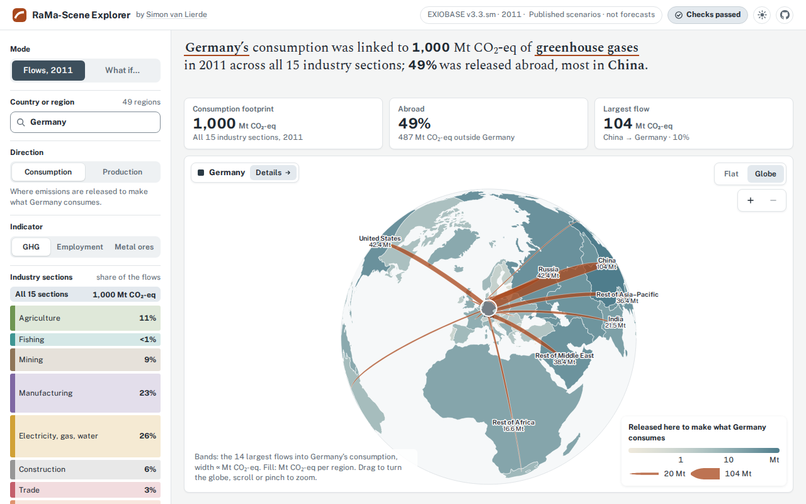

# RaMa-Scene Explorer

**What we consume connects us to environmental impacts across global supply chains.**
RaMa-Scene Explorer maps those connections for the world economy in 2011. Pick a
country and see where its consumption causes greenhouse-gas emissions, metal-ore
extraction and employment, at home and abroad. Then see how one change in one
place ripples through supply chains worldwide.

**[Open the explorer](https://simonvanlierde.com/ramascene-explorer/)**

<picture>
  <source media="(prefers-color-scheme: dark)" srcset="docs/img/explorer-dark.png">
  
</picture>

## Try it

1. Choose a country. The map shows where the goods and services it consumes are made.
2. Open **What if…**. The first scenario asks what happens if industry in China uses
   20% less coal power. World greenhouse-gas emissions fall, almost all of the cut happens
   in China, and it shrinks the footprint of every country that buys from China.
   [Read the map](docs/page.md#compare-a-scenario) gives the figures for each featured scenario.
3. Try the others, or set up your own change in the **Custom scenario** card below the list.

## What the results are

The explorer uses an input–output model of the 2011 economy, built from
[EXIOBASE](https://doi.org/10.5281/zenodo.3533196) data for 49 countries and regions.
It follows final demand, what households, governments and investors buy, back
through every supply chain to the industries that make it.

The scenarios change the 2011 economy and recalculate it. They are not forecasts.
Prices and everything else stay fixed, and nothing replaces what a scenario cuts.
"Jobs" counts the people employed to meet the demand, not full-time equivalents
or new jobs. [What each scenario changes](docs/scenarios.md) gives the exact definitions,
and the [reading guide](docs/page.md) explains the map.

## Documentation

[docs/README.md](docs/README.md) lists every document by reader: people reading
the results, researchers checking the method, and contributors.

## Cite

Cite the archived release: [doi:10.5281/zenodo.23461260](https://doi.org/10.5281/zenodo.23461260)
always points to the latest version. GitHub's "Cite this repository" button
reads [CITATION.cff](CITATION.cff). Cite EXIOBASE and the RaMa-Scene engine
separately (see below and [docs/precompute.md](docs/precompute.md)).

## Licence

The code is under the MIT licence (`LICENSE`), © 2026 Simon van Lierde.

The result files in `data/` are computed from **EXIOBASE v3.3.sm** by Franco
Donati and Arjan de Koning (Zenodo, version V1, 2019-11-08,
[doi:10.5281/zenodo.3533196](https://doi.org/10.5281/zenodo.3533196)), which
the Zenodo record publishes under
[Creative Commons Attribution 4.0 International (CC BY 4.0)](https://creativecommons.org/licenses/by/4.0/).
The result files hold scenario totals and flows. The optional
[browser export](docs/browser-engine.md) also includes matrices and derived
flow totals. All these data files are shared under CC BY 4.0. Reuse them with
credit to EXIOBASE v3.3.sm and its authors, as above, and say what was changed.

The fonts are Public Sans and Spectral, under the SIL Open Font License 1.1,
bundled from the `@fontsource` packages. The map geometry is Natural Earth,
public domain; its source is in [docs/page.md](docs/page.md#map-geometry).
