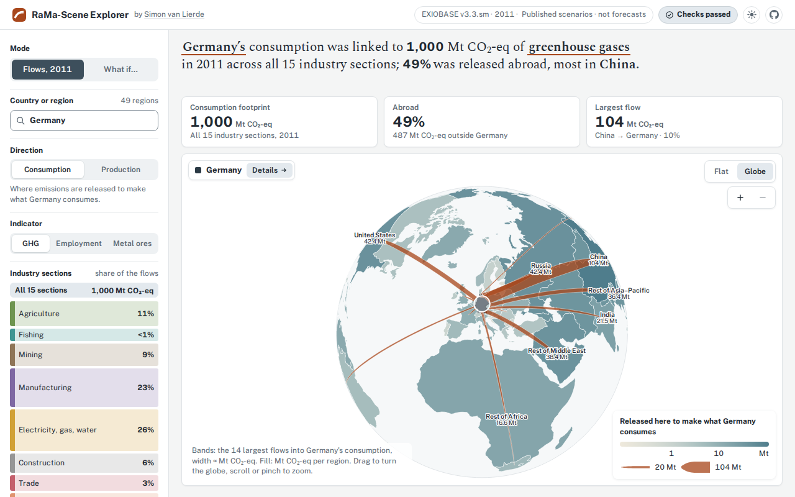

#  RaMa-Scene Explorer

Pick a country and follow its consumption back through global supply chains to the
greenhouse-gas emissions, metal-ore extraction and employment linked to it, at home and
abroad. Then change one thing in the economy and compare the result with the baseline.
RaMa-Scene Explorer maps these links for 49 countries and regions in 2011.

**[Open the explorer](https://simonvanlierde.com/ramascene-explorer/)**

<picture>
  <source media="(prefers-color-scheme: dark)" srcset="docs/img/explorer-dark.png">
  
</picture>

## Try it

1. Choose a country. The map shows where the selected indicator (emissions, employment or
   metal-ore extraction) occurs in the supply chains that serve the country's final demand.
   Choose World instead to see every region's total at once.
2. Open **What if…**. In the first scenario, every industry in China uses 20% less coal power
   made in China per unit of its output. World greenhouse-gas emissions fall, almost all of the
   cut happens in China, and it shrinks the footprint of every country that buys from China.
   [Read the map](docs/page.md#compare-a-scenario) gives the figures for each featured scenario.
3. Try the others, or set up your own scenario in the **Custom scenario** card below the list,
   with up to ten changes together.

## What the results are

The explorer uses an input–output model of the 2011 economy, built from
[EXIOBASE](https://doi.org/10.5281/zenodo.3533196) data for 49 countries and regions.
It follows final demand, what households, governments and investors buy, back
through every supply chain to the industries that make it.

The scenarios change the 2011 economy and recalculate every supply chain. They are not
forecasts. A scenario changes an input per unit of output, or spending on a product. Prices
and all other input requirements stay fixed, and nothing replaces what a scenario cuts.
"Jobs" counts the people employed to meet the demand, not full-time equivalents
or new jobs. [What each scenario changes](docs/scenarios.md) gives the exact definitions,
and the [reading guide](docs/page.md) explains the map.

## Documentation

The [documentation index](docs/README.md) lists every document by reader: people
reading the results, researchers checking the method, and contributors.

## Cite

Cite the explorer by its Zenodo concept DOI,
[doi:10.5281/zenodo.23461260](https://doi.org/10.5281/zenodo.23461260), which always
resolves to the latest release. To cite the exact version you used, take the version DOI
from that release's Zenodo page. GitHub's "Cite this repository" button
reads [CITATION.cff](CITATION.cff). Cite EXIOBASE and the RaMa-Scene engine
separately (see below and [docs/precompute.md](docs/precompute.md)).

## Licence

The code is under the MIT licence (`LICENSE`), © 2026 Simon van Lierde.

The result files in `data/` are computed from **EXIOBASE v3.3.sm** by Franco
Donati and Arjan de Koning (Zenodo, version V1, 2019-11-08,
[doi:10.5281/zenodo.3533196](https://doi.org/10.5281/zenodo.3533196)), which
the Zenodo record publishes under
[Creative Commons Attribution 4.0 International (CC BY 4.0)](https://creativecommons.org/licenses/by/4.0/).
The result files hold scenario totals and flows. The optional
[browser export](docs/browser-engine.md) also includes matrices and derived
flow totals. All these data files are shared under CC BY 4.0. Reuse them with
credit to EXIOBASE v3.3.sm and its authors, as above, and say what was changed.

The fonts are Public Sans and Spectral, under the SIL Open Font License 1.1,
bundled from the `@fontsource` packages. The map geometry is Natural Earth,
public domain; its source is in [docs/page.md](docs/page.md#map-geometry).
