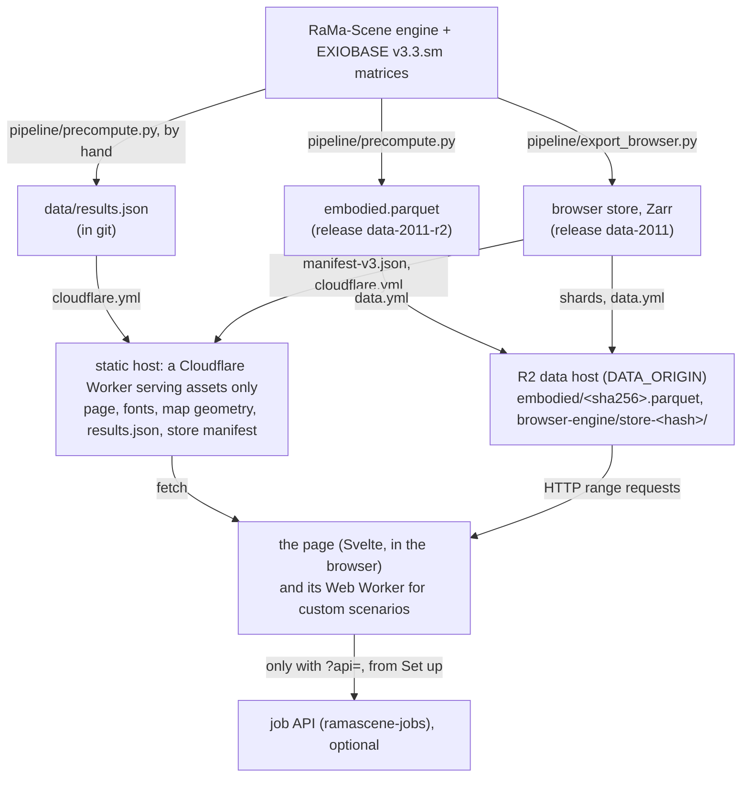

# Architecture

Last reviewed: 2026-11-15

The explorer has two halves. A Python script computes results once. A static
page then reads those results in the browser. The published site needs no calculation server.
Open it with `?api=` to connect an optional job API.

A worker computes custom scenarios from exported float32 matrices, in float64 arithmetic. It starts
when a reader opens the custom-scenario form. [browser-engine.md](browser-engine.md) describes its data and checks.



The page and the small files come from the static host; the two large files come from the
data host by their content hashes ([data host](publishing.md#data-host)). In development and
the tests, `DATA_ORIGIN` is unset and the page reads both next to itself, from `data/`.

Each part has its own page; [the docs index](README.md) links them all.

`index.html` loads `src/main.js`, which mounts `src/App.svelte`. The Svelte
files in `src/` draw the view. The logic that needs no browser lives in plain
modules in `src/lib/`, so `node --test` can test it:

| module | what it holds |
| --- | --- |
| `src/lib/messages.js` | the page's text, in one `en` object (the Ask panel's wording and the data-reload error stay outside), and the `LOCALE` every number and sort uses |
| `src/lib/explorer.js` | where the data file is (`?data=`), the synthetic-data banner, run matching |
| `src/lib/embodied.js` | reading the Parquet file by range request |
| `src/lib/range.js` | one byte-range read, with its stall timer and one retry, for the Parquet file and the Zarr store |
| `src/lib/flows.js` | sums, scales, units, the table and CSV, the URL parameters |
| `src/lib/map.js` | which map country belongs to which region |
| `src/lib/live.js` | the optional job API: origin check, request body, result reshaping |
| `src/lib/browser-engine/browser-engine.js` | the scenario planner and budgets, float64 Woodbury updates (a low-rank correction of the baseline inverse) |
| `engine/` | the Rust kernel, built to WebAssembly: the small linear solve and the flow sums |
| `src/lib/browser-engine/browser-data.js` | reading the Zarr store: shard indexes, coalesced range requests, row cache |
| `src/lib/browser-engine/browser-kernel.js` | loading the WebAssembly kernel, threaded where the page allows it |
| `src/lib/data-origin.js` | where a deployed build reads the large data (`DATA_ORIGIN`) |
| `src/lib/browser-engine/browser-results.js` | browser provenance and result shape |

`browser-client.js` sends requests to `browser-worker.js` (both in `src/lib/browser-engine/`), which loads the data
and computes off the main thread. The existing custom-scenario form uses either
that worker or the job API. Both hand the same flow layout to the map.

## Load published results

The page fetches `data/results.json`, then reads the Parquet footer using HTTP range requests.
It uses the file size in `provenance.embodied.bytes`.
If that record is missing or the file is not that size, it asks the host for the size with HEAD.
It reads the baseline row group to draw the map, then loads the default scenario when the browser is idle.
Other scenarios load on demand; the page keeps the 20 most recently viewed in memory.

The stylesheet (`src/app.css`) defines interface colours.
Data colours and the scales that use them are in `src/lib/flows.js`.

## First-load size

A cold first load of the live page, up to the default What if… run, transfers
about 1.10 MB (1,100,025 bytes, headers included) and unpacks to 1.81 MB. Data is
0.90 MB of that: `results.json` (64 KB compressed) and the map geometry (28 KB) from the
static host, and three range requests into `embodied.parquet` on the data host (the
footer, 132 KB; the baseline, 343 KB; the default run, 330 KB). The rest is the script
(102 KB), fonts (91 KB), CSS (9 KB) and HTML (2 KB). Measured on 2026-11-15, median of
three loads with the cache off:

```sh
pnpm measure-load [url] [runs]
```

## Map geometry

`geo/countries-110m.topo.json` is Natural Earth 1:110m Admin 0 – Countries,
**v5.1.2** (public domain), from
`nvkelso/natural-earth-vector` tag `v5.1.2`, `geojson/ne_110m_admin_0_countries.geojson`
(sha256 `6866c877…c977f`). I kept only the properties `iso` (`ISO_A2_EH`;
Somaliland as `SO`, N. Cyprus `null`) and `name`, dropped Antarctica and the
French Southern Lands, and converted it with `geo2topo -q 1e4`
(topojson-server 3.0.1).
